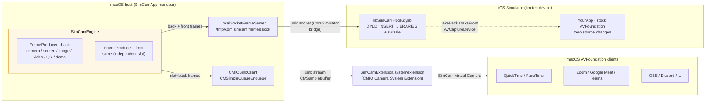

<div align="center">


# iOS-Simulator-Camera-Extend

**Give your iOS Simulator a real, working camera. Zero code changes, zero Apple Developer account, zero subscription.**

English ｜ [中文](README.md)


</div>

---

## The problem this solves

The iOS Simulator has no camera. The moment your app touches `AVCaptureSession`, QR scanning, face detection, AR, ID OCR, or video calling, you're forced onto a real device — or you sprinkle `#if targetEnvironment(simulator)` stubs everywhere.

[SimCam by Software Mansion](https://simcam.swmansion.com/) solves this elegantly, but requires a **$99/year Apple Developer account plus a paid license**.

This project is a **clean-room re-implementation** of that architecture, built for one audience:

> developers without a paid Apple account who just want to debug locally.

The app under test stays on **stock AVFoundation** — `AVCaptureDevice` / `AVCaptureSession` / `AVCaptureMetadataOutput` / `AVCaptureVideoPreviewLayer`. **Not a single line of business code changes, no re-signing, no bundle-id constraint.** Inside the Simulator it sees Mac-side cameras, the desktop, video files, and QR codes.

Built on public Apple APIs only (`ScreenCaptureKit` / `AVFoundation` / `CoreMediaIO` / `OSSystemExtensionRequest`) plus `DYLD_INSERT_LIBRARIES` on the Simulator side. **No private SPI, no jailbreak.**

> The CMIO sysext path needs a one-time minimal SIP relaxation: `csrutil enable --without kext --without debug`. Every other SIP protection (fs / nvram / dtrace) stays on; the Simulator hook path is fully user-space and SIP-agnostic. See [docs/no-developer-account.md §2.2.1](docs/no-developer-account.md). **Have a paid Apple Developer Program?** Use the Developer ID + Notarize route — SIP stays fully on, no `developer on` needed; see [§2.6](docs/no-developer-account.md#L479).

---

## Two pipelines

| What you want | Which pipeline |
|---|---|
| iOS app inside the iOS Simulator (your demo / business app / third-party) sees custom frames in camera preview / QR scanner / video calls | **Simulator hook** (`DYLD_INSERT_LIBRARIES` + AVFoundation swizzle) |
| On macOS, swap the camera feed for QuickTime / FaceTime / Zoom / Teams / Google Meet / OBS / Discord — any AVFoundation client | **CMIO sysext** (macOS Camera System Extension) |

Both pipelines share the same frame source (`SimCamEngine`) and can run **simultaneously**. Pick *FaceTime HD / Image / Video / QR / Simulator passthrough / any window or display* in the SimCam menubar and what QuickTime sees and what your iOS app inside the simulator sees are **frame-by-frame identical, switched in sync**.

**Core capabilities**:

- Zero changes to the app under test: no SDK / `import` / re-signing — use AVFoundation correctly and it Just Works.
- All standard AVFoundation paths intercepted: `AVCaptureDevice.DiscoverySession`, `AVCaptureSession.addInput`, `AVCaptureVideoDataOutput`, `AVCaptureMetadataOutput` (QR included), `AVCaptureVideoPreviewLayer`.
- Independent back / front slots, each with its own source.
- Simulator-window passthrough (default back): the camera "looks through" the Simulator window onto the desktop behind it, follows the window as you drag.
- Source types: Mac camera, full screen / single window / Simulator passthrough, local image / video file, QR generator, demo card.

---

## Architecture



> One frame source (`SimCamEngine`) fans out to two pipelines: the CMIO sysext exposes *SimCam Virtual Camera* to **every** macOS camera app; the DYLD hook lets the iOS app under test inside the Simulator see the host frames with zero source changes. Both pipelines share the same [SimCamCore](Sources/SimCamCore).

The wire protocol (48-byte v2 header with `cameraSlot`) is in [SimCamHook.h](Sources/SimCamHook/SimCamHook.h).

---

## CMIO virtual camera (macOS path)

> This section is dedicated to the CMIO pipeline. It is **fully independent** of the Simulator hook: you don't need an iOS Simulator, no dylib injection, no app under test. Once the sysext is installed, **every** macOS AVFoundation camera client (QuickTime, FaceTime, Zoom, Teams, Meet, OBS, Discord, Chrome / Safari WebRTC, Photo Booth …) will list a *SimCam Virtual Camera* in its camera dropdown.

<div align="center">

<br />
<sub>QuickTime → New Movie Recording → camera dropdown ticks <b>SimCam Virtual Camera</b>; the picture is whatever you picked in the SimCam menubar (Cat Camera live capture in this shot).</sub>
</div>

### Typical use cases

| Scenario | CMIO works | Notes |
|---|---|---|
| Screen / movie demo (QuickTime, OBS) | Yes | Pick SimCam Virtual Camera, route any desktop region or video file into a recording |
| Video meetings (Zoom, Teams, Google Meet, Webex) | Yes | Replace your camera feed with a video file / QR / desktop slide without disturbing the real one |
| WebRTC (Chrome, Safari, Firefox) | Yes | The browser picks SimCam Virtual Camera through AVCaptureDevice — handy for automated test fixtures |
| Live streaming (OBS, Streamlabs) | Yes | Feed a Display or app window into OBS as a Video Capture Device |
| Automated UI testing / screenshot fixtures | Yes | Use the `videoFile` source to pin a deterministic frame and run end-to-end tests on your camera UI |
| iOS app **inside iOS Simulator** seeing custom camera frames | No | The iOS SDK has no CMIO; you must use the [Simulator hook pipeline](#bring-up-the-simulator-hook-pipeline-let-your-ios-app-see-the-feed) |
| **Real iOS device** | No | iOS device cameras live outside the sandbox; impossible without kernel hooks. Out of scope here |

### Bring up the CMIO pipeline (4 commands)

You'll need: write access to `/Applications/` (sudo) + the `SimCam Local Dev` cert (`make bootstrap-cert`, one-shot) + `developer on` (resets on reboot) + a one-time minimal SIP relaxation (see [Requirements](#requirements)). **Have a paid Team account?** The Developer ID + Notarize route keeps SIP fully on and skips `developer on` — see [docs/no-developer-account.md §2.6](docs/no-developer-account.md#L479).

```bash
# One-time setup (per machine)
make bootstrap-cert
sudo systemextensionsctl developer on    # resets on reboot

# Install + run
make install                              # build + re-sign + copy to /Applications/ (sudo)
make run                                  # = make install + open SimCamApp.app
```

After launching:

1. The SimCam icon shows up in the menubar; open the popover.
2. macOS prompts *"System software from SimCam Local Dev was blocked"* on first activation → System Settings → Privacy & Security → Allow at the bottom → enter password.
3. **Cmd-Q QuickTime and relaunch it** (QuickTime caches the camera list at process start).
4. QuickTime → New Movie Recording → camera dropdown shows *SimCam Virtual Camera*.
5. From the SimCam menubar, switch *Back camera source* to FaceTime HD / Cat Camera / Image / Video / Simulator passthrough / any Display or Window — QuickTime updates live.

Verify:

```bash
systemextensionsctl list | grep simcam
# Expected: dev.simcam.app.extension  [activated enabled]

system_profiler SPCameraDataType | grep -A2 SimCam
# Expected: SimCam Virtual Camera
```

When something's off: run `make doctor` first, then read [docs/permissions-and-flow.md §3](docs/permissions-and-flow.md), and finally [docs/CMIO-LESSONS-LEARNED.md](docs/CMIO-LESSONS-LEARNED.md) (9 reversals / 5 missed pieces of evidence / 7 long-term tripwires — **read before touching CMIO code**).

---

## Requirements

### Required

| Item | Notes |
|---|---|
| **macOS** | 13+ (verified on 14 / 15 / 26) |
| **Xcode** | 15+, with `xcodebuild` / `xcrun simctl` / `codesign` / `security` available |
| **OpenSSL** | macOS LibreSSL `security` is enough; `bootstrap-cert.sh` uses OpenSSL 3.x (Homebrew or built-in on macOS 14+) |
| **A booted iOS Simulator** | Any model you want to test |

### Required only for the CMIO sysext pipeline

| Item | Notes |
|---|---|
| **One-time minimal SIP relaxation** | `csrutil enable --without kext --without debug` (run from Recovery Terminal then reboot; every other SIP protection — fs / nvram / dtrace — stays on). This is the prerequisite for `developer on` to accept non-Apple-anchored signatures; Apple's HIDDriverKit sample also says "Disable SIP" first. See [docs/no-developer-account.md §2.2.1](docs/no-developer-account.md) |
| **System-extension developer mode** | `sudo systemextensionsctl developer on` (resets on reboot, re-run after every restart) |
| **sudo access** | Installing a sysext requires copying the host bundle to `/Applications/` and `chown root:wheel` (sysextd's hard rule) |
| **Local self-signed cert: SimCam Local Dev** | One-shot `make bootstrap-cert`, generated and imported into login keychain; the private key is **never** committed |

> **Have a paid Apple Developer Program?** Use Developer ID Application + System Extension capability + notarize instead — the sysext rides the Apple anchor, SIP can stay fully enabled, no `developer on` needed. See [docs/no-developer-account.md §2.6](docs/no-developer-account.md#L479).

### Not required

- Paid Apple Developer Program ($99/yr) — replaced with a local self-signed cert (with a paid Team you can take the §2.6 route, skip the SIP relaxation and `developer on` altogether)
- Personal Team — verified that Personal Teams don't support the System Extension capability
- **Full** SIP disable (`csrutil disable`) — only the minimal relaxation above; do not turn more off
- Jailbreaks
- Changing your iOS app's source / SDK / bundle id

---

## Quick start

### One-time setup (do this once per machine)

```bash
# 1. Generate the local SimCam Local Dev code-signing cert and import it
make bootstrap-cert

# 2. Enable system-extension developer mode (resets on reboot)
sudo systemextensionsctl developer on
```

### Bring up the CMIO pipeline (macOS virtual camera)

For the full walkthrough, capability list, typical use cases and screenshot, see the dedicated [CMIO virtual camera (macOS path)](#cmio-virtual-camera-macos-path) section above. Command summary:

```bash
make install            # build + re-sign + copy to /Applications/ (needs sudo)
make run                # = make install + open SimCamApp.app
# Then any AVFoundation client (QuickTime / FaceTime / Zoom …) can pick "SimCam Virtual Camera".
```

### Bring up the Simulator hook pipeline (let your iOS app see the feed)

```bash
# Boot a simulator and install the demo app
open -a Simulator
xcrun simctl boot "iPhone 17 Pro" 2>/dev/null || true

xcodebuild -project SimCam.xcodeproj -scheme SimCamDemo \
    -configuration Debug \
    -destination 'generic/platform=iOS Simulator' build

xcrun simctl install booted \
    ~/Library/Developer/Xcode/DerivedData/SimCam-*/Build/Products/Debug-iphonesimulator/SimCamDemoApp.app

# Inject the hook and launch the demo (the host SimCamApp must be running)
./scripts/inject-simulator.sh dev.simcam.demo

# Expected: the demo app's back / front camera previews inside the simulator
# render whatever you picked in the SimCam menubar.
```

To use this with **your own** iOS app, just point the script at your bundle id:

```bash
xcrun simctl install booted /path/to/YourApp.app
./scripts/inject-simulator.sh com.yourcompany.YourApp
```

**Your app is not modified, recompiled, or re-signed; the bundle id stays the same.**

---

## Make targets at a glance

| target | what it does |
|---|---|
| `make bootstrap-cert` | **One-time**: generate the self-signed `SimCam Local Dev` cert and import it into login keychain |
| `make build` | xcodebuild Debug for host + extension |
| `make test` | xcodebuild test |
| `make install` | build + re-sign with full entitlements + copy to `/Applications/` + `chown root:wheel` (needs sudo) |
| `make run` | install + `open /Applications/SimCamApp.app` |
| `make doctor` | one-shot diagnostics: SIP / dev mode / signing / sysextd log / extension state |
| `make reset-tcc` | only after switching signing identity: wipe stale TCC entries |
| `make open` | open the Xcode project |
| `make clean` | wipe `build/` and `DerivedData/` |

The signing rationale lives in [docs/signing-and-tcc.md](docs/signing-and-tcc.md).

---

## Things this repo cannot do

- **Real-device** virtual camera: not possible. iOS device camera APIs live outside the sandbox; you'd need kernel-level hooks or a jailbreak. Out of scope here.
- A camera source for App Store apps: the dylib is injected only inside the *Simulator* process, never ends up in your `.ipa`, has no impact on App Store review — but it is also not a production "fake camera source".
- Skip injection and have the iOS app inside the simulator go through CMIO: physically impossible — the iOS SDK has no CMIO surface (same for the commercial SimCam). The SimCam tagline "without changing anything in your app" means **no changes to your iOS app's code / SDKs / bundle id**, not "no Mac-side injection".

---

## Troubleshooting cheat sheet

| Symptom | Check |
|---|---|
| `make install` fails with `'SimCam Local Dev' not found` | Run `make bootstrap-cert`; verify `security find-identity -v -p codesigning` lists SimCam Local Dev |
| `systemextensionsctl list` shows nothing | Run `make doctor`; common culprits: `sudo systemextensionsctl developer on` not run, host not in `/Applications/`, host owner ≠ root:wheel |
| sysext stuck at `[activated waiting for user]` | Approve in System Settings → Privacy & Security |
| *SimCam Virtual Camera* missing from QuickTime's camera list | sysext not activated (see above); or activated but host process not running → `make run` |
| Injected the simulator but no frames / `xcrun simctl spawn booted log stream` shows no `[SimCamHook]` lines | Wrong dylib path (must be `Build/Products/Debug-iphonesimulator/libSimCamHook.dylib`; the unsigned intermediate is silently rejected by dyld); or the host SimCamApp isn't running (`/tmp/com.simcam.frames.sock` missing) |
| iOS app reports `Camera permission denied` | Not an injection issue — the app under test is missing `NSCameraUsageDescription` in its own Info.plist |
| Changed hook code and the change didn't take effect | You must build the `SimCamDemo` scheme, not the `SimCam` scheme (the hook dylib is only built by SimCamDemo) |

A longer checklist lives in [docs/permissions-and-flow.md](docs/permissions-and-flow.md) §3 and [RUN_NOTES.md](RUN_NOTES.md).

---

## Documentation

| Doc | Topic |
|---|---|
| [README.md](README.md) | Chinese version |
| [docs/signing-and-tcc.md](docs/signing-and-tcc.md) | Why this repo uses a self-signed `SimCam Local Dev` cert and not ad-hoc / Personal Team / Developer Program |
| [docs/permissions-and-flow.md](docs/permissions-and-flow.md) | Permission matrix (screen recording / camera / system extensions), Hardened Runtime entitlements, full host → simulator frame flow, troubleshooting |
| [docs/no-developer-account.md](docs/no-developer-account.md) | Long-form runbook: end-to-end for both pipelines, TCC, SIP, `developer on`, recovery |
| [docs/CMIO-LESSONS-LEARNED.md](docs/CMIO-LESSONS-LEARNED.md) | **CMIO post-mortem** — 9 reversals / 5 missed pieces of evidence / 7 long-term tripwires. Read before touching CMIO code |
| [RUN_NOTES.md](RUN_NOTES.md) | Field notes for the iOS Simulator hook path (dyld / TCC / SC private API) |
| [Sources/SimCamHook/SimCamHook.h](Sources/SimCamHook/SimCamHook.h) | Wire protocol v2 (48-byte header, `cameraSlot`) |

---

## License

[MIT](LICENSE) — fork, modify, ship. This project is **not** affiliated with or endorsed by Software Mansion.
