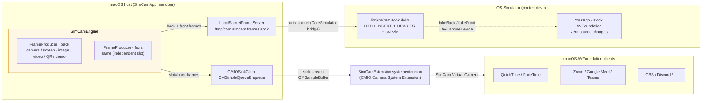
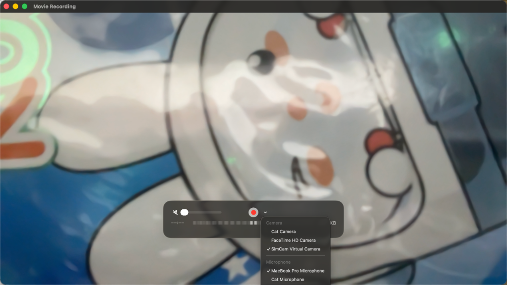

<div align="center">


# iOS-Simulator-Camera-Extend

**Give your iOS Simulator a real, working camera. Zero code changes, zero Apple Developer account, zero subscription.**

English ｜ [中文](README.md)


</div>

---

## The problem this solves

The iOS Simulator has no camera. The moment your app touches `AVCaptureSession`, QR scanning, face detection, AR, ID OCR, or video calling, you're forced onto a real device — or you sprinkle `#if targetEnvironment(simulator)` stubs everywhere.

[SimCam by Software Mansion](https://simcam.swmansion.com/) solves this elegantly, but requires a **$99/year Apple Developer account plus a paid license**.

This project is a **clean-room re-implementation** of that architecture, built for one audience:

> developers without a paid Apple account who just want to debug locally.

The app under test stays on **stock AVFoundation** — `AVCaptureDevice` / `AVCaptureSession` / `AVCaptureMetadataOutput` / `AVCaptureVideoPreviewLayer`. **Not a single line of business code changes, no re-signing, no bundle-id constraint.** Inside the Simulator it sees Mac-side cameras, the desktop, video files, and QR codes.

The whole thing is built on public Apple APIs (`ScreenCaptureKit` / `AVFoundation` / `CoreMediaIO` / `OSSystemExtensionRequest`) plus `DYLD_INSERT_LIBRARIES` on the Simulator side. **No private SPI, no jailbreak, no SIP-disable** for the Simulator path.

---

## What it does

- **Zero changes to the app under test**: no SDK, no `import`, no re-signing. Use AVFoundation correctly and it Just Works.
- **All standard AVFoundation paths intercepted**: `AVCaptureDevice.DiscoverySession`, `AVCaptureSession.addInput`, `AVCaptureVideoDataOutput`, `AVCaptureMetadataOutput` (QR included), `AVCaptureVideoPreviewLayer`.
- **Independent back / front slots**, each with its own source.
- **Simulator-window passthrough (default back)**: the camera "looks through" the Simulator window onto the desktop behind it, follows the window as you drag.
- **Many sources**: Mac camera, full screen / single window / Simulator passthrough, local image / video file, QR generator, demo card.
- **Optional macOS virtual camera**: a CMIO Camera System Extension so QuickTime / FaceTime / Zoom / OBS can also pick *SimCam Virtual Camera*.

---

## Architecture



> One frame source (`SimCamEngine`) fans out to two pipelines: the CMIO sysext exposes *SimCam Virtual Camera* to **every** macOS camera app; the DYLD hook lets the iOS app under test inside the Simulator see the host frames with zero source changes. Both pipelines share the same [SimCamCore](file:///Users/guoshuyu/workspace/swmansion-copy/Sources/SimCamCore).

The wire protocol (48-byte v2 header with `cameraSlot`) is in [SimCamHook.h](Sources/SimCamHook/SimCamHook.h).

<details>
<summary>Legacy architecture diagram (PNG)</summary>

<div align="center">

</div>

> ⚠️ **This PNG predates the self-signed CA workflow.** The bottom-right footnote *"Requires the macOS path (partial SIP relaxation)"* is **out-of-date**: today's recommended path keeps SIP fully enabled — no relaxation required. `csrutil enable --without kext --without debug` is only needed in two edge cases: lldb-attach-debugging the sysext, or insisting on the legacy ad-hoc-signed sysext path. See [docs/no-developer-account.md §2.2.1](docs/no-developer-account.md). Use the mermaid diagram + ASCII fallback above as the source of truth.

</details>

<details>
<summary>ASCII fallback</summary>

```
┌────────────────────── macOS host ─────────────────────────┐
│  SimCamApp.app  (menubar)                                 │
│   ┌──────────────────────────────────────────────────┐    │
│   │  SimCamEngine                                    │    │
│   │   ├─ FrameProducer (per slot: back / front)      │    │
│   │   │   • CameraDeviceFrameProducer (AVFoundation) │    │
│   │   │   • ScreenFrameProducer (ScreenCaptureKit)   │    │
│   │   │       ├─ display / window                    │    │
│   │   │       └─ followSimulator (locks onto window) │    │
│   │   │   • Image / Video / QR / DemoCard            │    │
│   │   ├─→ CMIO sink ──► SimCamExtension.systemextension   │
│   │   └─→ LocalSocketFrameServer ──► /tmp/com.simcam.…sock │
│   └──────────────────────────────────────────────────┘    │
│                                                           │
│   ┌─────────── iOS Simulator ────────────────────────┐    │
│   │  YourApp  (stock AVFoundation, untouched)        │    │
│   │   ▲                                              │    │
│   │   │  swizzle  (DYLD_INSERT_LIBRARIES)            │    │
│   │   │                                              │    │
│   │  libSimCamHook.dylib                             │    │
│   │   • fakeBack / fakeFront AVCaptureDevice         │    │
│   │   • frame puller @ unix socket                   │    │
│   │   • fan out to sample buffer / metadata / preview│    │
│   └──────────────────────────────────────────────────┘    │
└───────────────────────────────────────────────────────────┘
```

</details>

---

## What works today

Both pipelines are wired up and can run **at the same time**:

| What you want | Which pipeline | Who it serves |
|---|---|---|
| Run your iOS app **inside iOS Simulator** and have its camera preview / QR scanner / video-call code see custom frames | **Simulator hook pipeline** (`DYLD_INSERT_LIBRARIES` + AVFoundation swizzle) | Any iOS app inside the simulator (the bundled demo, your business app, third-party apps) |
| On **macOS**, swap the camera feed for QuickTime / FaceTime / Zoom / Teams / Google Meet / OBS / Discord — any AVFoundation client | **CMIO sysext pipeline** (macOS Camera System Extension) | Any macOS AVFoundation client |

**Both pipelines share the same source**: pick *FaceTime HD / Image / Video / QR / Simulator passthrough / any window or display* in the SimCam menubar, and what QuickTime sees and what your iOS app inside the simulator sees are **identical, switched in sync**.

> ⚠️ **An iOS app inside the Simulator cannot reach the CMIO sysext directly** — the iOS SDK has no CMIO surface area. This is an Apple platform limitation, not something this project can solve, and it is the same for the commercial SimCam. So "iOS apps inside the simulator see the SimCam feed" must go through the hook pipeline. This does **not** contradict the SimCam tagline "without changing anything in your app" — that means **you don't change your iOS app's code / SDKs / bundle id**, not that no Mac-side injection is required.

---

## CMIO virtual camera (macOS path)

> This section is dedicated to the CMIO pipeline. It is **fully independent** of the Simulator hook: you don't need an iOS Simulator, no dylib injection, no app under test. Once the sysext is installed, **every** macOS AVFoundation camera client (QuickTime, FaceTime, Zoom, Teams, Meet, OBS, Discord, Chrome / Safari WebRTC, Photo Booth …) will list a *SimCam Virtual Camera* in its camera dropdown.

<div align="center">

<br />
<sub>QuickTime → New Movie Recording → camera dropdown ticks <b>SimCam Virtual Camera</b>; the picture is whatever you picked in the SimCam menubar (Cat Camera live capture in this shot).</sub>
</div>

### What it can do

- **A real macOS virtual camera**: registered as an `AVCaptureDevice` at the system layer, picked up by every AVFoundation client without per-app virtual-camera plugins.
- **Switch the source on the fly**: FaceTime HD / Continuity Camera / any Display / any Window / Simulator passthrough (camera "looks through" the simulator window to the desktop) / local image / local video / QR generator / demo card — toggled live from the SimCam menubar.
- **Real resolution / FPS**: defaults to 1920×1080 / 30fps, follows the actual frame attributes; no letterboxing or upscaling.
- **Same source as the Simulator hook**: what the CMIO clients see and what the simulator hook delivers are **frame-by-frame identical**; you can run both pipelines simultaneously.
- **Public APIs only**: pure `CoreMediaIO` / `OSSystemExtensions` / `CMIOExtension*`. No private SPI, no jailbreak, no SIP relaxation.

### Typical use cases

| Scenario | CMIO works | Notes |
|---|---|---|
| Screen / movie demo (QuickTime, OBS) | ✅ | Pick SimCam Virtual Camera, route any desktop region or video file into a recording |
| Video meetings (Zoom, Teams, Google Meet, Webex) | ✅ | Replace your camera feed with a video file / QR / desktop slide without disturbing the real one |
| WebRTC (Chrome, Safari, Firefox) | ✅ | The browser picks SimCam Virtual Camera through AVCaptureDevice — handy for automated test fixtures |
| Live streaming (OBS, Streamlabs) | ✅ | Feed a Display or app window into OBS as a Video Capture Device |
| Automated UI testing / screenshot fixtures | ✅ | Use the `videoFile` source to pin a deterministic frame and run end-to-end tests on your camera UI |
| iOS app **inside iOS Simulator** seeing custom camera frames | ❌ | The iOS SDK has no CMIO; you must use the [Simulator hook pipeline](#bring-up-the-simulator-hook-pipeline-let-your-ios-app-see-the-feed) |
| **Real iOS device** | ❌ | iOS device cameras live outside the sandbox; impossible without kernel hooks. Out of scope here |

### What you need (CMIO-only)

In addition to the [Requirements](#requirements) section:

1. **Write access to `/Applications/`** (sudo): hard rule from sysextd — the host bundle must launch from `/Applications/SimCamApp.app` and be owned by `root:wheel`. `make install` packages this for you.
2. **`sudo systemextensionsctl developer on`**: lets sysextd accept non-Apple-anchored signatures (this repo uses a self-signed CA). **Resets on every reboot** — re-run after each restart.
3. **Local code-signing cert *SimCam Local Dev***: `make bootstrap-cert` once, private key stays in your keychain, never committed. The full set of entitlements is injected at re-sign time by [scripts/install-systemext.sh](scripts/install-systemext.sh) — independent of Xcode automatic signing.
4. **Approve in System Settings on first activation**: macOS *requires* the user to allow the sysext once via *Privacy & Security*. Subsequent rebuilds never re-prompt because the designated requirement is pinned to the certificate CN ([docs/signing-and-tcc.md](docs/signing-and-tcc.md)).

> You do **not** need: SIP relaxation, a paid Apple Developer Program, or a Personal Team.

### Bring up the CMIO pipeline (4 commands)

```bash
# One-time setup (per machine)
make bootstrap-cert
sudo systemextensionsctl developer on    # resets on reboot

# Install + run
make install                              # build + re-sign + copy to /Applications/ (sudo)
make run                                  # = make install + open SimCamApp.app
```

After launching:

1. The SimCam icon shows up in the menubar; open the popover.
2. macOS prompts *"System software from SimCam Local Dev was blocked"* on first activation → System Settings → Privacy & Security → Allow at the bottom → enter password.
3. **Cmd-Q QuickTime and relaunch it** (QuickTime caches the camera list at process start, so any client running before the sysext registered won't see the new device).
4. QuickTime → New Movie Recording → camera dropdown shows *SimCam Virtual Camera*.
5. From the SimCam menubar, switch *Back camera source* to FaceTime HD / Cat Camera / Image / Video / Simulator passthrough / any Display or Window — QuickTime updates live.

Verify:

```bash
systemextensionsctl list | grep simcam
# Expected: dev.simcam.app.extension  [activated enabled]

system_profiler SPCameraDataType | grep -A2 SimCam
# Expected: SimCam Virtual Camera
```

### When the CMIO pipeline misbehaves

Walk these three in order — they cover roughly 99% of failures:

1. `make doctor` — one-shot health check (SIP / developer mode / signing identity / install location / sysextd log for the last 5 minutes).
2. [docs/permissions-and-flow.md §3](docs/permissions-and-flow.md) — permissions matrix and triage.
3. [docs/CMIO-LESSONS-LEARNED.md](docs/CMIO-LESSONS-LEARNED.md) — our own one-night-of-debugging post-mortem (9 reversals / 5 missed pieces of evidence / 7 long-term tripwires). **Read this before changing anything CMIO-related.**

---

## Requirements

### Required

| | Notes |
|---|---|
| **macOS** | 13+ (verified on 14 / 15 / 26) |
| **Xcode** | 15+, with `xcodebuild` / `xcrun simctl` / `codesign` / `security` available |
| **OpenSSL** | macOS LibreSSL `security` is enough; `bootstrap-cert.sh` uses OpenSSL 3.x (Homebrew or built-in on macOS 14+) |
| **A booted iOS Simulator** | Any model you want to test |

### Required only for the CMIO sysext pipeline

| | Notes |
|---|---|
| **System-extension developer mode** | `sudo systemextensionsctl developer on` (resets on reboot, re-run after every restart) |
| **sudo access** | Installing a sysext requires copying the host bundle to `/Applications/` and `chown root:wheel` (sysextd's hard rule) |
| **Local self-signed cert: SimCam Local Dev** | One-shot `make bootstrap-cert`, generated and imported into login keychain; the private key is **never** committed |

### **Not** required

- ❌ Paid Apple Developer Program ($99/yr) — replaced with a local self-signed cert
- ❌ Personal Team — verified that Personal Teams don't support the System Extension capability
- ❌ Disabling SIP, jailbreaking
- ❌ Changing your iOS app's source / SDK / bundle id

---

## Quick start

### One-time setup (do this once per machine)

```bash
# 1. Generate the local SimCam Local Dev code-signing cert and import it
make bootstrap-cert

# 2. Enable system-extension developer mode (resets on reboot)
sudo systemextensionsctl developer on
```

### Bring up the CMIO pipeline (macOS virtual camera)

For the full walkthrough, capability list, typical use cases and screenshot, see the dedicated [CMIO virtual camera (macOS path)](#cmio-virtual-camera-macos-path) section above. Command summary:

```bash
make install            # build + re-sign + copy to /Applications/ (needs sudo)
make run                # = make install + open SimCamApp.app
# Then any AVFoundation client (QuickTime / FaceTime / Zoom …) can pick "SimCam Virtual Camera".
```

### Bring up the Simulator hook pipeline (let your iOS app see the feed)

```bash
# 7. Boot a simulator and install the demo app
open -a Simulator
xcrun simctl boot "iPhone 17 Pro" 2>/dev/null || true

xcodebuild -project SimCam.xcodeproj -scheme SimCamDemo \
    -configuration Debug \
    -destination 'generic/platform=iOS Simulator' build

xcrun simctl install booted \
    ~/Library/Developer/Xcode/DerivedData/SimCam-*/Build/Products/Debug-iphonesimulator/SimCamDemoApp.app

# 8. Inject the hook and launch the demo (the host SimCamApp must be running)
./scripts/inject-simulator.sh dev.simcam.demo

# Expected: the demo app's back / front camera previews inside the simulator
# render whatever you picked in the SimCam menubar.
```

To use this with **your own** iOS app, just point the script at your bundle id:

```bash
xcrun simctl install booted /path/to/YourApp.app
./scripts/inject-simulator.sh com.yourcompany.YourApp
```

**Your app is not modified, recompiled, or re-signed; the bundle id stays the same.**

---

## Make targets at a glance

| target | what it does |
|---|---|
| `make bootstrap-cert` | **One-time**: generate the self-signed `SimCam Local Dev` cert and import it into login keychain |
| `make build` | xcodebuild Debug for host + extension |
| `make test` | xcodebuild test |
| `make install` | build + re-sign with full entitlements + copy to `/Applications/` + `chown root:wheel` (needs sudo) |
| `make run` | install + `open /Applications/SimCamApp.app` |
| `make doctor` | one-shot diagnostics: SIP / dev mode / signing / sysextd log / extension state |
| `make reset-tcc` | only after switching signing identity: wipe stale TCC entries |
| `make open` | open the Xcode project |
| `make clean` | wipe `build/` and `DerivedData/` |

The signing rationale lives in [docs/signing-and-tcc.md](docs/signing-and-tcc.md).

---

## Things this repo cannot do

- **Real-device** virtual camera: not possible. iOS device camera APIs live outside the sandbox; you'd need kernel-level hooks or a jailbreak. Out of scope here.
- A camera source for App Store apps: the dylib is injected only inside the *Simulator* process, never ends up in your `.ipa`, has no impact on App Store review — but it is also not a production "fake camera source".
- Skip injection and have the iOS app inside the simulator go through CMIO: see the boxed note above. Apple's SDK boundary makes this physically impossible.

---

## Troubleshooting cheat sheet

| Symptom | Check |
|---|---|
| `make install` fails with `'SimCam Local Dev' not found` | Run `make bootstrap-cert`; verify `security find-identity -v -p codesigning` lists SimCam Local Dev |
| `systemextensionsctl list` shows nothing | Run `make doctor`; common culprits: `sudo systemextensionsctl developer on` not run, host not in `/Applications/`, host owner ≠ root:wheel |
| sysext stuck at `[activated waiting for user]` | Approve in System Settings → Privacy & Security |
| *SimCam Virtual Camera* missing from QuickTime's camera list | sysext not activated (see above); or activated but host process not running → `make run` |
| Injected the simulator but no frames / `xcrun simctl spawn booted log stream` shows no `[SimCamHook]` lines | Wrong dylib path (must be `Build/Products/Debug-iphonesimulator/libSimCamHook.dylib`; the unsigned intermediate is silently rejected by dyld); or the host SimCamApp isn't running (`/tmp/com.simcam.frames.sock` missing) |
| iOS app reports `Camera permission denied` | Not an injection issue — the app under test is missing `NSCameraUsageDescription` in its own Info.plist |
| Changed hook code and the change didn't take effect | You must build the `SimCamDemo` scheme, not the `SimCam` scheme (the hook dylib is only built by SimCamDemo) |

A longer checklist lives in [docs/permissions-and-flow.md](docs/permissions-and-flow.md) §3 and [RUN_NOTES.md](RUN_NOTES.md).

---

## Documentation

| Doc | Topic |
|---|---|
| [README.md](README.md) | Chinese version |
| [docs/signing-and-tcc.md](docs/signing-and-tcc.md) | Why this repo uses a self-signed `SimCam Local Dev` cert and not ad-hoc / Personal Team / Developer Program |
| [docs/permissions-and-flow.md](docs/permissions-and-flow.md) | Permission matrix (screen recording / camera / system extensions), Hardened Runtime entitlements, full host → simulator frame flow, troubleshooting |
| [docs/no-developer-account.md](docs/no-developer-account.md) | Long-form runbook: end-to-end for both pipelines, TCC, SIP, `developer on`, recovery |
| [docs/CMIO-LESSONS-LEARNED.md](docs/CMIO-LESSONS-LEARNED.md) | **CMIO post-mortem** — 9 reversals / 5 missed pieces of evidence / 7 long-term tripwires. Read before touching CMIO code |
| [docs/HANDOFF-2026-06-03.md](docs/HANDOFF-2026-06-03.md) | CMIO debugging session snapshot + the final sink-stream-selection root cause (kept as historical record) |
| [RUN_NOTES.md](RUN_NOTES.md) | Field notes for the iOS Simulator hook path (dyld / TCC / SC private API) |
| [Sources/SimCamHook/SimCamHook.h](Sources/SimCamHook/SimCamHook.h) | Wire protocol v2 (48-byte header, `cameraSlot`) |

---

## License

[MIT](LICENSE) — fork, modify, ship. This project is **not** affiliated with or endorsed by Software Mansion.
