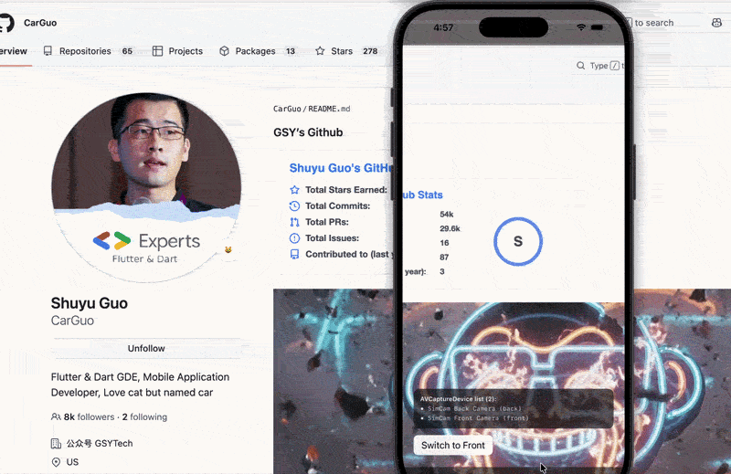

<div align="center">


# iOS-Simulator-Camera-Extend

**Give your iOS Simulator a real, working camera —
zero code changes, zero Apple Developer account, zero subscription.**

English ｜ [中文](README.md)



</div>

---

## What it is

[SimCam by Software Mansion](https://simcam.swmansion.com/) is an excellent commercial macOS app that finally fixes the long-standing "iOS Simulator has no real camera" pain. The price tag:
**$99/year Apple Developer account + paid license**.

**This repo** is a **clean-room re-implementation** of that architecture, built for one audience —

> developers who don't have a paid Apple account and just want to debug locally on their own machine.

The app under test stays on **stock AVFoundation** (`AVCaptureDevice` / `AVCaptureSession` / `AVCaptureMetadataOutput` / `AVCaptureVideoPreviewLayer`). **Not a single business line gets changed**, and inside the Simulator it sees Mac-side cameras, the desktop, video files, QR codes, …

Everything is built on public Apple APIs (`ScreenCaptureKit` / `AVFoundation` / `CoreMediaIO` / `OSSystemExtensionRequest`) plus `DYLD_INSERT_LIBRARIES` on the Simulator side. **No private SPI, no jailbreak, no SIP-disable** (for the Simulator path).

---

## What it does

| Feature | Notes |
|---|---|
| 🎥 **Independent back / front slots** | Two producers, one source picker each |
| 🪟 **Simulator passthrough** (default `back`) | Camera "looks through" the Simulator window onto the desktop behind it, follows window drag |
| 📷 **All standard AVFoundation paths intercepted** | DiscoverySession / addInput / VideoDataOutput / MetadataOutput (QR) / VideoPreviewLayer |
| 🛡️ **Zero changes to the app under test** | No SDK, no `import`, no bundle-id constraint. Use AVF correctly and it Just Works |
| 🖥️ **macOS-side virtual camera** | CMIO Camera System Extension — usable from QuickTime / FaceTime / Zoom / OBS (requires partial SIP relaxation) |
| 🧰 **No paid Apple account needed** | Free Personal Team is enough (ad-hoc works for the Simulator path alone) |

---

## Architecture in one picture

```
┌─────────────────────── macOS host ───────────────────────────┐
│                                                              │
│   SimCamApp.app  (menubar)                                   │
│   ┌─────────────────────────────────────────────────────┐    │
│   │  SimCamEngine                                        │    │
│   │   ├─ FrameProducer (per slot: back / front)          │    │
│   │   │   • CameraDeviceFrameProducer  (AVFoundation)    │    │
│   │   │   • ScreenFrameProducer         (ScreenCaptureKit)    │
│   │   │     ├─ raw display / window                      │    │
│   │   │     └─ followSimulator: locks sourceRect onto     │    │
│   │   │       the Simulator window                       │    │
│   │   │   • Image / Video / QR / DemoCard                │    │
│   │   ├─→ CMIO sink stream  ──►  SimCamExtension.systemext   │
│   │   └─→ LocalSocketFrameServer  ──►  /tmp/com.simcam.…sock │
│   └─────────────────────────────────────────────────────┘    │
│                                                              │
│   ┌──────────── iOS Simulator ────────────────────────┐      │
│   │  YourApp  (stock AVFoundation, untouched)         │      │
│   │   ▲                                               │      │
│   │   │  swizzle (DYLD_INSERT_LIBRARIES)              │      │
│   │   │                                               │      │
│   │  libSimCamHook.dylib                              │      │
│   │   • fakeBack / fakeFront AVCaptureDevice          │      │
│   │   • frame puller @ unix sock — back/front slots   │      │
│   │   • fans frames out to sample-buffer / metadata / │      │
│   │     preview-layer                                  │      │
│   └───────────────────────────────────────────────────┘      │
└──────────────────────────────────────────────────────────────┘
```

For the wire protocol (48-byte v2 header with `cameraSlot`), see [SimCamHook.h](Sources/SimCamHook/SimCamHook.h).
For the full theory of operation and the three categories of system permissions, see [docs/permissions-and-flow.md](docs/permissions-and-flow.md) (Chinese).

---

## Quick start (Simulator path — recommended first run)

You only need a free Apple ID, Xcode 15+, and `xcodegen`.

```bash
# 1. Generate the Xcode project
brew install xcodegen
make open                          # = xcodegen + open SimCam.xcodeproj

# 2. Build the host menubar app
xcodebuild -scheme SimCam -configuration Debug \
  -derivedDataPath build/SimCamDD build

# 3. Build the demo + the injected dylib
#    (must be the SimCamDemo scheme — SimCam scheme does NOT build the dylib)
xcodebuild -project SimCam.xcodeproj -scheme SimCamDemo \
  -sdk iphonesimulator -arch arm64 -configuration Debug build

# 4. Boot a simulator and install the demo app
xcrun simctl boot "iPhone 17 Pro" 2>/dev/null || true
open -a Simulator
xcrun simctl install booted \
  ~/Library/Developer/Xcode/DerivedData/SimCam-*/Build/Products/Debug-iphonesimulator/SimCamDemoApp.app

# 5. Launch the host menubar app
open build/SimCamDD/Build/Products/Debug/SimCamApp.app

# 6. Inject the hook into the demo app
./scripts/inject-simulator.sh dev.simcam.demo
```

You should now see the demo app inside the Simulator with a `Switch to Front` button and live frames coming from the host. The default `back` source is **Simulator passthrough** — drag the Simulator window around and the camera content follows the desktop behind it.

To use this with **your own** app, just point the script at your bundle id:

```bash
xcrun simctl install booted /path/to/YourApp.app
./scripts/inject-simulator.sh com.yourcompany.YourApp
```

Your app does not need to be modified, recompiled, or re-signed. **Zero integration code.**

---

## macOS path (CMIO virtual camera — optional, advanced)

If you also want `SimCam Virtual Camera` to show up in QuickTime / FaceTime / Zoom on the host Mac:

1. Boot into Recovery and run `csrutil enable --without debug --without kext` (this is a **partial** SIP relaxation, not a full disable);
2. `sudo systemextensionsctl developer on`;
3. Install `SimCamApp.app` into `/Applications/` (sysextd refuses to load extensions from DerivedData paths);
4. Launch it and accept the system-extension prompt in *System Settings → Privacy & Security*.

Step-by-step instructions and recovery commands for "I bricked my install" live in [docs/no-developer-account.md](docs/no-developer-account.md). **You can skip this entire section if you only care about the Simulator path.**

---

## Targets / Schemes

| Target | Kind | Role |
|---|---|---|
| **SimCamApp** | macOS app | menubar UI + `SimCamEngine` + unix-sock frame server + extension activator |
| **SimCamExtension** | system extension (embedded in SimCamApp) | CMIO virtual camera implementation |
| **SimCamHook** | iOS-Simulator dylib (Obj-C) | `DYLD_INSERT_LIBRARIES` payload — swizzles AVFoundation |
| **SimCamDemoApp** | iOS app (runs in simulator) | Sample app proving the "stock AVFoundation" claim — no SimCam dependency |
| **SimCamCoreTests** | XCTest bundle | engine, QR, license, frame producer unit tests |

| Scheme | Builds |
|---|---|
| `SimCam` | SimCamApp + SimCamExtension + SimCamCoreTests |
| `SimCamDemo` | **SimCamHook** + SimCamDemoApp |

⚠️ Always rebuild `SimCamDemo` after touching `SimCamHook.m`. The `SimCam` scheme does not depend on the dylib target, so a `-scheme SimCam` build will leave you running the previous hook binary.

---

## Repository layout

```
project.yml                     # xcodegen recipe
Makefile                        # generate / build / test / run shortcuts
Generated/                      # Info.plist + entitlements (gitignored, regenerated)
SimCam.xcodeproj/               # gitignored, regenerated
Sources/
  SimCamCore/                   # engine, frame producers, unix-sock server, QR
  SimCamExtension/              # CMIO Camera System Extension
  SimCamApp/                    # menubar host (AppDelegate / MenubarView)
  SimCamHook/                   # ⭐ Obj-C dylib injected into the simulator process
  SimCamDemoApp/                # iOS demo (stock AVFoundation, no SimCam imports)
Tests/SimCamCoreTests/
scripts/
  bootstrap-xcode.sh            # brew install xcodegen
  inject-simulator.sh           # SIMCTL_CHILD_DYLD_INSERT_LIBRARIES launcher
  install-systemext.sh          # cp to /Applications + entitlement bypass
  diagnose-sysext.sh            # one-shot sysextd log dump
  reset-tcc.sh                  # one-shot wipe of stale ad-hoc TCC entries
docs/
  assets/                       # README assets (logo / demo gif)
  permissions-and-flow.md       # Three permissions + end-to-end flow + troubleshooting (Chinese)
  no-developer-account.md       # Long-form runbook (Chinese)
RUN_NOTES.md                    # Field notes & gotchas (Chinese)
README.md / README.en.md
```

---

## Documentation

| Doc | Topic |
|---|---|
| [README.md](README.md) | Chinese (primary) |
| [README.en.md](README.en.md) | You are here |
| [docs/permissions-and-flow.md](docs/permissions-and-flow.md) | Triggers for screen-recording / camera / system-extension permissions, Hardened Runtime entitlement matrix, full host → simulator frame flow, troubleshooting |
| [docs/no-developer-account.md](docs/no-developer-account.md) | Long-form runbook: TCC, ad-hoc signing, system-extension activation, recovery |
| [RUN_NOTES.md](RUN_NOTES.md) | Field notes from the clean-room re-implementation |
| [Sources/SimCamHook/SimCamHook.h](Sources/SimCamHook/SimCamHook.h) | Wire protocol v2 (48-byte header, `cameraSlot`) |

---

## Known gotchas (short list)

The full version with reproductions and root-cause analyses lives in [RUN_NOTES.md](RUN_NOTES.md) and [docs/no-developer-account.md](docs/no-developer-account.md). Highlights:

- **`SimCam` scheme does not build `SimCamHook`.** Always rebuild `SimCamDemo` after editing the hook.
- **Unsigned dylibs are silently ignored** by the iOS-17+ simulator's dyld. Inject only from `Build/Products/Debug-iphonesimulator/` (already ad-hoc signed by Xcode); the `Intermediates.noindex/.../Binary/` copy is unsigned and won't load.
- **TCC screen-recording grants vanish on rebuild** because ad-hoc signing changes the cdhash that TCC keys on. The project now signs with a Personal Team to fix this — see [RUN_NOTES.md §4](RUN_NOTES.md).
- **macOS 14+ `SCShareableContent` does NOT throw on missing permission.** It silently returns `displays = []` and windows with `owningApplication == nil`. We use "displays empty AND windows ownerless" as the unauthorized signal.
- **With Hardened Runtime ON, missing camera entitlement makes `AVCaptureDevice.requestAccess` return NO silently** — no prompt, no entry in System Settings. `project.yml` already declares `device.camera` / `audio-input` / `disable-library-validation` explicitly.

---

## Roadmap

- [ ] Multi-simulator support (currently picks the largest Simulator window)
- [ ] CLI for headless CI usage (no menubar, source picked via flags)
- [ ] Per-slot resolution / FPS controls in the UI
- [ ] Continuity Camera as a first-class source (already works via the generic camera path)
- [ ] Optional H.264 wire encoding to lower CPU on busy hosts
- [ ] Notarization-signed release for users with a paid account

PRs welcome.

---

## License

[MIT](LICENSE) — feel free to fork, extend, ship.

This project is **not** affiliated with or endorsed by Software Mansion. It re-implements the publicly documented architecture of [simcam.swmansion.com](https://simcam.swmansion.com/) using only public Apple APIs. **No** SimCam source code was used, viewed, or copied. If you need a polished, supported, notarized product — please buy a SimCam license; the original team did the hard design work and deserves your money.

## Acknowledgements

- [Software Mansion / SimCam](https://simcam.swmansion.com/) — for proving the architecture is feasible and for the excellent UX that inspired this clone.
- Apple's `ScreenCaptureKit`, `AVFoundation`, and `CoreMediaIO` framework engineers for the public APIs that make this possible.
