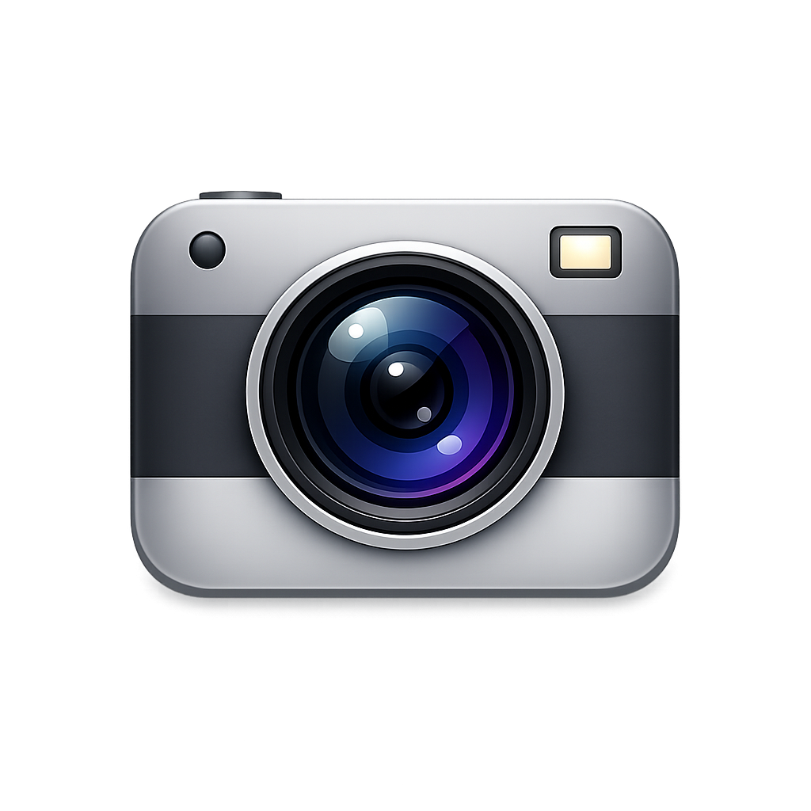
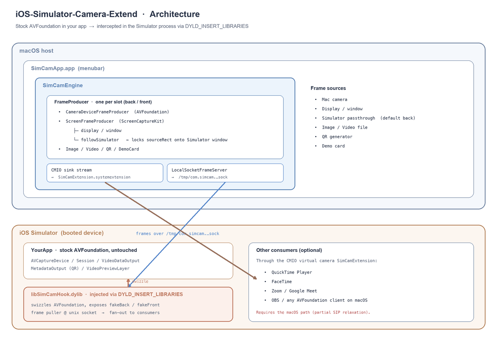

<div align="center">



# iOS-Simulator-Camera-Extend

**给 iOS Simulator 一台真正能用的相机。零代码改动，零开发者账号，零订阅费。**

[English](README.en.md) ｜ 中文


</div>

---

## 它解决什么问题

iOS Simulator 没有相机。一旦你的 app 涉及 `AVCaptureSession`、扫码、人脸、AR、ID OCR、视频通话——你只能跑真机，或者写一堆 `#if targetEnvironment(simulator)` 假数据兜底。

[SimCam (Software Mansion)](https://simcam.swmansion.com/) 用一种很巧妙的架构解决了这件事，但它需要 **$99/年 Apple Developer 账号 + 商业 license**。

本项目是这套架构的**clean-room 复刻**，目标只有一个：

> 让没有付费 Apple 账号、只想本机调试的开发者也能用上同样的能力。

被测 app 完全使用 **标准 AVFoundation** —— `AVCaptureDevice` / `AVCaptureSession` / `AVCaptureMetadataOutput` / `AVCaptureVideoPreviewLayer` ——**一行业务代码不改，不重新签名，不换 bundle id**。在 Simulator 里就能拿到 Mac 的摄像头、桌面、视频文件、二维码画面。

整套实现仅依赖 Apple 公开 API（`ScreenCaptureKit` / `AVFoundation` / `CoreMediaIO` / `OSSystemExtensionRequest`）+ iOS Simulator 上的 `DYLD_INSERT_LIBRARIES`。**没有私有 SPI，不越狱，不关 SIP**（Simulator 路径而言）。

---

## 能做什么

- **被测 app 零侵入**：不需要 SDK、不需要 `import`、不需要重新签名。AVFoundation 用得对，开箱即用。
- **拦截全部标准 AVFoundation 路径**：`AVCaptureDevice.DiscoverySession`、`AVCaptureSession.addInput`、`AVCaptureVideoDataOutput`、`AVCaptureMetadataOutput`（含二维码）、`AVCaptureVideoPreviewLayer`。
- **后置 / 前置双槽位独立**：每个槽位独立挑选帧源。
- **Simulator 窗口穿透（默认后置）**：相机"看穿" Simulator 这扇窗，呈现它背后的桌面，跟随窗口移动。
- **多种帧源**：Mac 摄像头、整屏 / 单窗口 / Simulator passthrough、本地图片 / 视频、二维码生成器、demo 卡片。
- **macOS 端虚拟摄像头（可选）**：CMIO Camera System Extension，让 QuickTime / FaceTime / Zoom / OBS 也能选用 *SimCam Virtual Camera*。

---

## 架构

<div align="center">

</div>

帧线协议（48 字节 v2 头 + `cameraSlot`）见 [SimCamHook.h](Sources/SimCamHook/SimCamHook.h)。

<details>
<summary>ASCII 版（fallback）</summary>

```
┌────────────────────── macOS host ─────────────────────────┐
│  SimCamApp.app  (menubar)                                 │
│   ┌──────────────────────────────────────────────────┐    │
│   │  SimCamEngine                                    │    │
│   │   ├─ FrameProducer (per slot: back / front)      │    │
│   │   │   • CameraDeviceFrameProducer (AVFoundation) │    │
│   │   │   • ScreenFrameProducer (ScreenCaptureKit)   │    │
│   │   │       ├─ display / window                    │    │
│   │   │       └─ followSimulator (跟随 Simulator 窗口) │    │
│   │   │   • Image / Video / QR / DemoCard            │    │
│   │   ├─→ CMIO sink ──► SimCamExtension.systemextension   │
│   │   └─→ LocalSocketFrameServer ──► /tmp/com.simcam.…sock │
│   └──────────────────────────────────────────────────┘    │
│                                                           │
│   ┌─────────── iOS Simulator ────────────────────────┐    │
│   │  YourApp  (stock AVFoundation, untouched)        │    │
│   │   ▲                                              │    │
│   │   │  swizzle  (DYLD_INSERT_LIBRARIES)            │    │
│   │   │                                              │    │
│   │  libSimCamHook.dylib                             │    │
│   │   • fakeBack / fakeFront AVCaptureDevice         │    │
│   │   • frame puller @ unix socket                   │    │
│   │   • fan out to sample buffer / metadata / preview│    │
│   └──────────────────────────────────────────────────┘    │
└───────────────────────────────────────────────────────────┘
```

</details>

---

## 开始之前你需要知道

这个项目**不是 App Store 的成品**，而是一个 clean-room 复刻仓库。能不能跑起来取决于你愿意接受哪条路线：

### 路线 A：Simulator 路径（推荐，零门槛）

| 你需要 | 说明 |
|---|---|
| 免费 Apple ID | 不用付费 Apple Developer Program |
| Xcode 15+ | 用免费 Personal Team 给 host app 做 ad-hoc 签名 |
| `xcodegen`、`make` | `brew install xcodegen` |
| 第一次同意 *屏幕录制 / 相机* TCC 弹窗 | 系统级，正常用户授权 |

完成上面这些就能跑通：被测 iOS app 在 Simulator 里"看到"Mac 的相机/桌面/视频文件/二维码画面，**完全无需付费 Apple 账号**。

### 路线 B：macOS 虚拟摄像头路径（可选）

只有当你想让 QuickTime / FaceTime / Zoom 这类 macOS app 也能选 *SimCam Virtual Camera* 时才需要。它涉及 CMIO Camera System Extension —— Apple 对系统扩展的部署有严格要求，没有付费账号的话只剩**部分降级 SIP** 一条路：

| 你需要 | 说明 |
|---|---|
| 进 Recovery 改 SIP | `csrutil enable --without debug --without kext`（保留绝大部分保护，仅放开 debugger / kext 加载） |
| `sudo systemextensionsctl developer on` | 允许加载未公证的系统扩展 |
| 把 `SimCamApp.app` 装到 `/Applications/` | sysextd 拒绝从 DerivedData 加载扩展 |

> 如果你**不愿动 SIP**，又确实需要 macOS 端虚拟摄像头：唯一干净的路是花 **$99/年 Apple Developer Program**，然后用付费证书 + Notarization 让系统扩展正常激活。这个仓库不为你处理签名/公证，直接买 [SimCam](https://simcam.swmansion.com/) 在体验上更优。

### 完全不行的场景

- 想给**真机**虚拟相机：不可能。iOS 真机相机 API 在沙箱外，需要内核级 hook 或越狱，本仓库不涉及。
- 想发布到 App Store 的 app 用它：本仓库的 dylib 注入只在 *Simulator* 进程内有效，不进 ipa，对 App Store 审核没影响 —— 但它也不是给生产用的"假相机源"。

---

## 快速开始（Simulator 路径）

只需要：免费 Apple ID + Xcode 15+ + `xcodegen`。

```bash
# 1. 生成 Xcode 工程
brew install xcodegen
make open

# 2. build host menubar app
xcodebuild -scheme SimCam -configuration Debug \
  -derivedDataPath build/SimCamDD build

# 3. build demo + 注入用 dylib（必须 SimCamDemo scheme，SimCam scheme 不带 dylib）
xcodebuild -project SimCam.xcodeproj -scheme SimCamDemo \
  -sdk iphonesimulator -arch arm64 -configuration Debug build

# 4. 启动 simulator + 安装 demo
xcrun simctl boot "iPhone 17 Pro" 2>/dev/null || true
open -a Simulator
xcrun simctl install booted \
  ~/Library/Developer/Xcode/DerivedData/SimCam-*/Build/Products/Debug-iphonesimulator/SimCamDemoApp.app

# 5. 启动 host menubar app
open build/SimCamDD/Build/Products/Debug/SimCamApp.app

# 6. 把 hook 注入到 demo
./scripts/inject-simulator.sh dev.simcam.demo
```

跑通的样子：simulator 里的 demo app 出现 *Switch to Front* 按钮，画面是 host 推过来的。默认后置源是 **Simulator passthrough** —— 拖动 Simulator 窗口，相机画面就跟着背后桌面走。

把它接到**自己的 app**上，把 bundle id 换成自己的即可：

```bash
xcrun simctl install booted /path/to/YourApp.app
./scripts/inject-simulator.sh com.yourcompany.YourApp
```

被测 app 不改一行代码，不重新编译，不重新签名。

---

## macOS 路径（CMIO 虚拟摄像头，可选）

如果你还想让 *SimCam Virtual Camera* 出现在 QuickTime / FaceTime / Zoom：

1. 进 Recovery 跑 `csrutil enable --without debug --without kext`（**部分**降级 SIP，不是全关）。
2. `sudo systemextensionsctl developer on`。
3. 把 `SimCamApp.app` 安装到 `/Applications/`（sysextd 不接受 DerivedData 路径）。
4. 启动它，去 *系统设置 → 隐私与安全性* 点允许。

完整步骤、踩坑恢复见 [docs/no-developer-account.md](docs/no-developer-account.md)。**只用 Simulator 路径可以跳过整段。**

---

## 文档

| 文档 | 内容 |
|---|---|
| [README.en.md](README.en.md) | English version |
| [docs/permissions-and-flow.md](docs/permissions-and-flow.md) | 屏幕录制 / 摄像头 / 系统扩展三类权限的触发点、Hardened Runtime entitlement 矩阵、host → simulator 完整帧流、故障排查 |
| [docs/no-developer-account.md](docs/no-developer-account.md) | 长版 runbook：TCC、ad-hoc 签名、系统扩展激活、踩坑恢复 |
| [RUN_NOTES.md](RUN_NOTES.md) | 复刻过程踩到的非显然坑 + 根因 |
| [Sources/SimCamHook/SimCamHook.h](Sources/SimCamHook/SimCamHook.h) | 帧线协议 v2（48 字节头 + `cameraSlot`） |

---

## About

iOS Simulator 没有相机这件事，我和大多数 iOS 开发者一样吃过苦头：每次写涉及拍照、扫码、人脸、AR 的功能，都得来回插拔真机，或者写一坨假数据兜底。Software Mansion 的 SimCam 把这个问题解得很优雅 —— 但它要 $99/年开发者账号 + 商业 license，对很多个人开发者、自学者、教学课堂、内部工具团队来说门槛偏高。

这个仓库是**一次纯粹的工程练习**：仅依据 [simcam.swmansion.com](https://simcam.swmansion.com/) 公开记录的架构（menubar host + `DYLD_INSERT_LIBRARIES` swizzle + 可选 CMIO 系统扩展），用 Apple 公开 API（`ScreenCaptureKit` / `AVFoundation` / `CoreMediaIO` / `OSSystemExtensionRequest`）从零复刻。**没有任何 SimCam 代码被使用、查看或复制。**

目标只有两条：让没有付费 Apple 账号的开发者也能在 Simulator 里调相机功能；把整个实现过程的踩坑（TCC、Hardened Runtime entitlement、CMIO 系统扩展激活流程）原汁原味记录在文档里，方便后人少绕路。

如果你最终的需求是**生产级**、**长期支持**、**已公证**的虚拟相机：请买 SimCam 商业版，原团队做了所有难的设计工作，值得这笔钱。如果你只是想本机调试 / 教学 / 做内部工具，欢迎用、改、fork。

---

## License

[MIT](LICENSE) — fork、改、ship。本项目**不**附属于、也未被 Software Mansion 背书。
