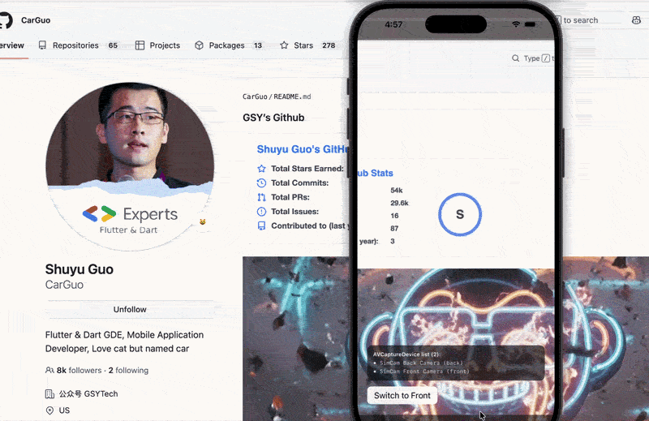
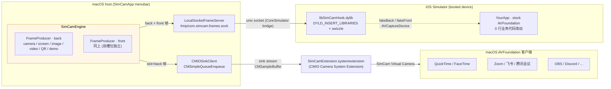

<div align="center">


# iOS-Simulator-Camera-Extend

**给 iOS Simulator 一台真正能用的相机。零代码改动，零开发者账号，零订阅费。**

[English](README.en.md) ｜ 中文



</div>

---

## 它解决什么问题

iOS Simulator 没有相机。一旦你的 app 涉及 `AVCaptureSession`、扫码、人脸、AR、ID OCR、视频通话——你只能跑真机，或者写一堆 `#if targetEnvironment(simulator)` 假数据兜底。

[SimCam (Software Mansion)](https://simcam.swmansion.com/) 用一种很巧妙的架构解决了这件事，但它需要 **$99/年 Apple Developer 账号 + 商业 license**。

本项目是这套架构的**clean-room 复刻**，目标只有一个：

> 让没有付费 Apple 账号、只想本机调试的开发者也能用上同样的能力。

被测 app 完全使用 **标准 AVFoundation** —— `AVCaptureDevice` / `AVCaptureSession` / `AVCaptureMetadataOutput` / `AVCaptureVideoPreviewLayer` ——**一行业务代码不改，不重新签名，不换 bundle id**。在 Simulator 里就能拿到 Mac 的摄像头、桌面、视频文件、二维码画面。

整套实现仅依赖 Apple 公开 API（`ScreenCaptureKit` / `AVFoundation` / `CoreMediaIO` / `OSSystemExtensionRequest`）+ iOS Simulator 上的 `DYLD_INSERT_LIBRARIES`。**没有私有 SPI，不越狱**。macOS host 端跑 CMIO sysext **需要一次性最小化降级 SIP**（`csrutil enable --without kext --without debug`）以便 `systemextensionsctl developer on` 接受 self-signed 签名；其余 SIP 保护（fs / nvram / dtrace）保留。iOS Simulator hook 链路完全跑在用户态，不需要任何 SIP 动作。详见 [docs/no-developer-account.md §2.2.1](file:///Users/guoshuyu/workspace/swmansion-copy/docs/no-developer-account.md)。

---

## 能做什么

- **被测 app 零侵入**：不需要 SDK、不需要 `import`、不需要重新签名。AVFoundation 用得对，开箱即用。
- **拦截全部标准 AVFoundation 路径**：`AVCaptureDevice.DiscoverySession`、`AVCaptureSession.addInput`、`AVCaptureVideoDataOutput`、`AVCaptureMetadataOutput`（含二维码）、`AVCaptureVideoPreviewLayer`。
- **后置 / 前置双槽位独立**：每个槽位独立挑选帧源。
- **Simulator 窗口穿透（默认后置）**：相机"看穿" Simulator 这扇窗，呈现它背后的桌面，跟随窗口移动。
- **多种帧源**：Mac 摄像头、整屏 / 单窗口 / Simulator passthrough、本地图片 / 视频、二维码生成器、demo 卡片。
- **macOS 端虚拟摄像头（可选）**：CMIO Camera System Extension，让 QuickTime / FaceTime / Zoom / OBS 也能选用 *SimCam Virtual Camera*。

---

## 架构



> 一份帧源（`SimCamEngine`）同时投到两条链路：CMIO sysext 让 macOS 上**任何**相机 app 看到 SimCam Virtual Camera；DYLD hook 让 iOS Simulator 里被测 app 拿到 host 推过来的画面（业务代码不改）。两条链路共享同一份 [SimCamCore](file:///Users/guoshuyu/workspace/swmansion-copy/Sources/SimCamCore)。

帧线协议（48 字节 v2 头 + `cameraSlot`）见 [SimCamHook.h](Sources/SimCamHook/SimCamHook.h)。

---

## 现在能做什么

两条链路都打通了，可以**同时**用：

| 你想要的效果 | 走哪条链路 | 服务对象 |
|---|---|---|
| 在 **iOS Simulator 里**跑你的 iOS app，让它的相机预览 / 扫码 / 视频通话拿到自定义画面 | **Simulator hook 链路**（`DYLD_INSERT_LIBRARIES` + AVFoundation swizzle） | 任何 simulator 内的 iOS app（你的 demo、你公司业务 app、第三方 app） |
| 在 **macOS 上**用 QuickTime / FaceTime / Zoom / 飞书 / 腾讯会议 / OBS / Discord 等任意 AVFoundation 客户端，把摄像头切成自定义画面 | **CMIO sysext 链路**（macOS Camera System Extension） | 任何 macOS AVFoundation 客户端 |

**两条链路共享同一个画面源**：你在 SimCam menubar 里把 back/front 切到 *FaceTime HD / Image / Video / QR / Simulator passthrough / 任意窗口或 Display*，QuickTime 看到的画面、simulator 内 iOS app 看到的画面**完全同源、同步切换**。

> 注意：**iOS Simulator 内 iOS app 不可能直接走 CMIO** —— iOS SDK 里根本没有 CMIO 接口，这是 Apple 平台的硬限制（不是本项目能解决的，SimCam 商业版同样如此）。所以"让 simulator 里 iOS app 看到 SimCam 画面"必须走 hook 链路。这跟 SimCam 官网"without changing anything in your app"承诺并不矛盾——指的是**你 iOS app 代码不改 / 不引 SDK / 不换 bundle id**，并不是不需要在 Mac 一侧做注入步骤。

---

## CMIO 虚拟摄像头（macOS 链路）

> 这一节专门介绍 CMIO 链路。它的能力相对于 Simulator hook 是**完全独立的**：你**不需要** iOS Simulator、不需要任何 dylib 注入、不需要被测 app；只要 sysext 装上，**任何**走 macOS AVFoundation 的相机 app（QuickTime、FaceTime、Zoom、腾讯会议、飞书、OBS、Discord、Chrome、Safari WebRTC、Photo Booth …）都会在它的相机下拉里看到一台 *SimCam Virtual Camera*。

<div align="center">

<br />
<sub>QuickTime → New Movie Recording → Camera 下拉勾选 <b>SimCam Virtual Camera</b>，画面是 SimCam menubar 切到的画面源（这里是 Cat Camera 实拍）。</sub>
</div>

### 它能做什么

- **macOS 一台真正的虚拟摄像头**：在系统层注册成一台 `AVCaptureDevice`，所有遵循 AVFoundation 的客户端都能选；不依赖各家 app 的"虚拟相机插件"机制。
- **画面源任你切**：FaceTime HD / Continuity Camera / 任意 Display / 任意窗口 / Simulator passthrough（看穿 simulator 这扇窗到桌面）/ 本地图片 / 本地视频 / 二维码生成器 / Demo 卡片，在 SimCam menubar 一键切换。
- **真实分辨率 / 帧率**：默认 1920×1080 / 30fps，跟随源帧实际属性，不做 letterbox / scale up。
- **与 Simulator hook 同源**：CMIO 客户端看到的画面和 simulator hook 链路看到的**逐帧一致**，两条管子可以同时开。
- **零私有 SPI**：纯 Apple 公开 API（`CoreMediaIO` / `OSSystemExtensions` / `CMIOExtension*`），不越狱。CMIO sysext 路线一次性最小化降级 SIP（`csrutil enable --without kext --without debug`）即可 —— 让 `systemextensionsctl developer on` 接受本仓库的 self-signed CA 签名；其它 SIP 保护全部保留。

### 典型使用场景

| 场景 | 走 CMIO | 说明 |
|---|---|---|
| 录屏 / 录视频 demo（QuickTime, OBS） | 是 | 直接选 SimCam Virtual Camera，把任意桌面区域 / 视频文件录进去 |
| 视频会议（Zoom, Teams, Google Meet, 腾讯会议, 飞书） | 是 | 把摄像头换成本地视频文件 / 二维码 / 桌面演示，**不影响**自家摄像头 |
| WebRTC（Chrome, Safari, Firefox） | 是 | 浏览器走 AVCaptureDevice 选 SimCam Virtual Camera，方便自动化测试 |
| 直播（OBS, Streamlabs） | 是 | 把 Display / 应用窗口当摄像头喂进 OBS 的 Video Capture Device |
| 自动化 UI 测试 / 截图素材 | 是 | 用 `videoFile` 源喂固定画面，跑 e2e 测试相机界面 |
| **iOS Simulator 里**的 iOS app 看到自定义相机画面 | 否 | iOS SDK 没有 CMIO，必须走 [Simulator hook 链路](#跑通-simulator-hook-链路让-ios-app-看到画面) |
| **iOS 真机** | 否 | iOS 真机相机在沙箱外，无内核级 hook 不可能；本仓库不涉及 |

### 运行 CMIO 链路需要什么

只列**额外**于 [环境准备](#环境准备) 的项：

1. **`/Applications/` 写权限**（sudo）：sysextd 硬约束，host bundle 必须从 `/Applications/SimCamApp.app` 起动，且 owner 必须是 `root:wheel`。`make install` 已经把这套封装好了。
2. **`sudo systemextensionsctl developer on`**：让 sysextd 接受非 Apple anchor 签名（本仓库走 self-signed CA）。**重启失效**，每次开机得重开。
3. **本地代码签名证书 SimCam Local Dev**：`make bootstrap-cert` 一次性生成，私钥留 keychain，不入仓。配套 entitlements 全部走 [scripts/install-systemext.sh](scripts/install-systemext.sh) 在重签时注入，不依赖 Xcode 自动签名。
4. **首次激活时去 System Settings 点 Allow**：sysext 一定要用户在 *Privacy & Security* 里同意一次，这是 Apple 强制的。之后任何 rebuild 不再弹（DR 锁 CN，TCC 不失忆，详见 [docs/signing-and-tcc.md](docs/signing-and-tcc.md)）。

> 完全 **不需要** 关 SIP、不需要付费 Apple Developer Program、不需要 Personal Team。

### 跑通 CMIO 链路（4 条命令）

```bash
# 一次性 setup（每台机器一次）
make bootstrap-cert
sudo systemextensionsctl developer on    # 重启失效，每次开机重开

# 装 + 跑
make install                              # build + 重签 + 拷到 /Applications/（sudo）
make run                                  # = make install + open SimCamApp.app
```

启动后：

1. 菜单栏出现 SimCam 图标，点开 popover；
2. 第一次激活，macOS 会弹 *"系统软件已被阻止 SimCam Local Dev"* → 去 System Settings → Privacy & Security → 最下面点 Allow → 输入密码；
3. 任意时刻 **Cmd-Q 退掉 QuickTime 重启一次**（QuickTime 是长时间运行进程，会缓存启动那一刻的相机列表）；
4. QuickTime → New Movie Recording → Camera 下拉，能看到 *SimCam Virtual Camera*；
5. 在 menubar 把 *Back camera source* 切到 FaceTime HD / Cat Camera / Image / Video / Simulator passthrough / 任意 Display 或 Window，QuickTime 里实时切。

验证：

```bash
systemextensionsctl list | grep simcam
# 期望：dev.simcam.app.extension  [activated enabled]

system_profiler SPCameraDataType | grep -A2 SimCam
# 期望：SimCam Virtual Camera
```

### CMIO 链路出问题怎么办

按这三条按顺序看，走过 99% 故障：

1. `make doctor` —— 一键体检 SIP、developer mode、签名身份、host 安装位置、sysextd 最近 5 分钟日志；
2. [docs/permissions-and-flow.md §3](docs/permissions-and-flow.md) —— 权限矩阵 + 故障排查；
3. [docs/CMIO-LESSONS-LEARNED.md](docs/CMIO-LESSONS-LEARNED.md) —— 我们自己一晚上踩坑反转 9 次的复盘，每条都有"症状 / 反证 / 不要再走"的红线，强烈建议**改 CMIO 相关代码前先扫一遍**。

---

## 环境准备

### 必须

| 项 | 说明 |
|---|---|
| **macOS** | 13+（开发机用 macOS 14/15/26 都验过） |
| **Xcode** | 15+，命令行工具齐全（`xcodebuild` / `xcrun simctl` / `codesign` / `security`）|
| **OpenSSL** | macOS 自带 LibreSSL 的 `security` 工具够用；`bootstrap-cert.sh` 会用 OpenSSL 3.x（Homebrew 装的或 macOS 14+ 自带） |
| **booted iOS Simulator** | 要测哪台机型自己 boot；一台就够 |

### 仅 CMIO sysext 链路需要

| 项 | 说明 |
|---|---|
| **SIP developer mode** | `sudo systemextensionsctl developer on`（重启失效，每次开机要重开一次） |
| **sudo 权限** | 装 sysext 必须把 host bundle 拷到 `/Applications/` 并 `chown root:wheel`（sysextd 的硬约束） |
| **本地自签名证书 SimCam Local Dev** | 一次性，`make bootstrap-cert` 生成并导入 keychain；私钥不入仓 |

### 不需要

- 付费 Apple Developer Program（$99/年）—— 用本地自签名证书替代
- Personal Team —— 已验证 Personal Team 不支持 System Extension capability
- 关 SIP / 越狱
- 改 iOS app 代码、装 SDK、换 bundle id

---

## Quick start

### 一次性 setup（每台开发机做一次）

```bash
# 1. 生成本地代码签名证书 SimCam Local Dev，导入 login keychain
make bootstrap-cert

# 2. 打开 macOS 系统扩展开发者模式（重启失效）
sudo systemextensionsctl developer on
```

### 跑通 CMIO 链路（macOS 上的虚拟摄像头）

完整步骤、能力清单、典型使用场景、截图，见上面的 [CMIO 虚拟摄像头（macOS 链路）](#cmio-虚拟摄像头macos-链路) 章节。命令汇总：

```bash
make install            # build + 重签 + 拷到 /Applications/（需 sudo）
make run                # = make install + open SimCamApp.app
# 然后 QuickTime / FaceTime / Zoom 任意 AVFoundation 客户端选 "SimCam Virtual Camera"
```

### 跑通 Simulator hook 链路（让 iOS app 看到画面）

```bash
# 启动一台 simulator + 装 demo app
open -a Simulator
xcrun simctl boot "iPhone 17 Pro" 2>/dev/null || true

xcodebuild -project SimCam.xcodeproj -scheme SimCamDemo \
    -configuration Debug \
    -destination 'generic/platform=iOS Simulator' build

xcrun simctl install booted \
    ~/Library/Developer/Xcode/DerivedData/SimCam-*/Build/Products/Debug-iphonesimulator/SimCamDemoApp.app

# 注入 hook 并启动 demo（host SimCamApp 必须在跑）
./scripts/inject-simulator.sh dev.simcam.demo

# 期望：simulator 里 SimCamDemoApp 的 back / front 摄像头预览
# 实时显示 SimCam menubar 选中的画面源
```

把它用在**你自己**的 iOS app 上，bundle id 换掉即可：

```bash
xcrun simctl install booted /path/to/YourApp.app
./scripts/inject-simulator.sh com.yourcompany.YourApp
```

**你的 app 一行代码都不用改，不重编、不重签、不换 bundle id。**

---

## Make targets 一览

| target | 作用 |
|---|---|
| `make bootstrap-cert` | **一次性**：生成 self-signed `SimCam Local Dev` 证书并导入 login keychain |
| `make build` | xcodebuild Debug 配置 build host + extension |
| `make test` | xcodebuild test |
| `make install` | build + 重签（注入完整 entitlements）+ 拷到 `/Applications/` + `chown root:wheel`（需 sudo）|
| `make run` | install + `open /Applications/SimCamApp.app` |
| `make doctor` | 一键诊断：SIP / 开发者模式 / 签名 / sysextd 日志 / extension 状态 |
| `make reset-tcc` | 切换签名身份后才需要：清掉旧 TCC 记录 |
| `make open` | 打开 Xcode 工程 |
| `make clean` | 清掉 `build/` 和 `DerivedData/` |

签名机制详见 [docs/signing-and-tcc.md](docs/signing-and-tcc.md)。

---

## 完全不行的场景

- **真机**虚拟相机：不可能。iOS 真机相机 API 在沙箱外，需要内核级 hook 或越狱，本仓库不涉及。
- 想发布到 App Store 的 app 用它：本仓库的 dylib 注入只在 *Simulator* 进程内有效，不进 ipa，对 App Store 审核没影响 —— 但它也不是给生产用的"假相机源"。
- 不想 inject、想让 simulator 内 iOS app 走 CMIO 那条管子：见上面方框里的解释，物理上不可能。

---

## 故障排查速查

| 现象 | 检查 |
|---|---|
| `make install` 报 `'SimCam Local Dev' not found` | 跑 `make bootstrap-cert`；确认 `security find-identity -v -p codesigning` 列表里有 SimCam Local Dev |
| `systemextensionsctl list` 看不到 extension | 跑 `make doctor`；常见根因：没开 `sudo systemextensionsctl developer on`、host 没在 `/Applications/`、host owner 不是 root:wheel |
| sysext 状态是 `[activated waiting for user]` | 去 System Settings → Privacy & Security → 最下面点 Allow |
| QuickTime 摄像头列表里没有 *SimCam Virtual Camera* | sysext 没 activated（看上一行）；或 sysext activated 了但 host 没启动 → `make run` |
| 注入 simulator 后看不到画面 / `xcrun simctl spawn booted log stream` 没有 `[SimCamHook]` 行 | dylib 路径错（必须是 `Build/Products/Debug-iphonesimulator/libSimCamHook.dylib`，未签名 intermediate 那份会被 dyld 静默拒绝），或 host SimCamApp 没在跑（`/tmp/com.simcam.frames.sock` 不存在）|
| iOS app 报 `Camera permission denied` | 不是注入的问题，是被测 app 自己 Info.plist 缺 `NSCameraUsageDescription` |
| 改了 hook 代码、注入没生效 | 必须 build `SimCamDemo` scheme，不是 `SimCam` scheme（hook dylib 只在 SimCamDemo scheme 里 build） |

更长的排查清单见 [docs/permissions-and-flow.md](docs/permissions-and-flow.md) §3 和 [RUN_NOTES.md](RUN_NOTES.md)。

---

## 文档

| 文档 | 内容 |
|---|---|
| [README.en.md](README.en.md) | English version |
| [docs/signing-and-tcc.md](docs/signing-and-tcc.md) | self-signed `SimCam Local Dev` 证书的设计动机；为什么不用 ad-hoc / Personal Team / Developer Program |
| [docs/permissions-and-flow.md](docs/permissions-and-flow.md) | 屏幕录制 / 摄像头 / 系统扩展三类权限矩阵、Hardened Runtime entitlement、host → simulator 完整帧流、故障排查 |
| [docs/no-developer-account.md](docs/no-developer-account.md) | 长版 runbook：双链路端到端步骤、TCC、SIP、`developer on`、踩坑恢复 |
| [docs/CMIO-LESSONS-LEARNED.md](docs/CMIO-LESSONS-LEARNED.md) | **CMIO 实现踩坑历史**：9 次反转 / 5 个关键证据 / 7 条长期红线，改 CMIO 代码前先扫这一份 |
| [RUN_NOTES.md](RUN_NOTES.md) | iOS Simulator hook 链路踩到的非显然坑 + 根因（dyld / TCC / SC 私有 API） |
| [Sources/SimCamHook/SimCamHook.h](Sources/SimCamHook/SimCamHook.h) | 帧线协议 v2（48 字节头 + `cameraSlot`） |

---

## License

[MIT](LICENSE) — fork、改、ship。本项目**不**附属于、也未被 Software Mansion 背书。
